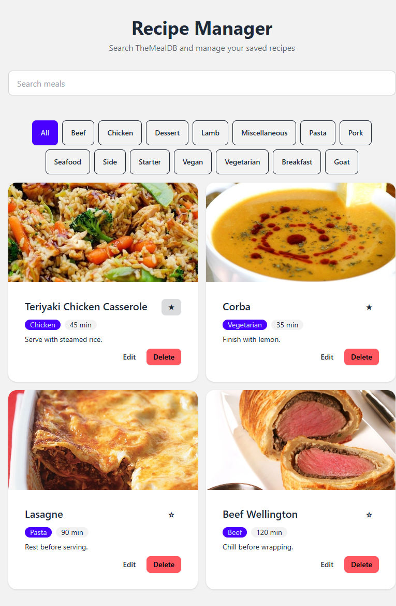

# Recipe Manager

A data-driven recipe application built with React, TypeScript, Axios, and TanStack Query. Users can search recipes from TheMealDB, save recipes, edit cooking time and notes, manage favorites, and filter saved recipes.

## Live Demo

https://recipe-manager-sepia.vercel.app/

## Technologies Used

- React
- TypeScript
- Axios
- TanStack Query
- TheMealDB API
- JSON Server
- Tailwind CSS
- DaisyUI

## Installation and Setup

1. Clone the repository.
2. Install dependencies:

   ```bash
   npm install
   ```

3. Create a `.env` file in the project root using `.env.example` as a guide.

4. Start the local JSON Server:

   ```bash
   npm run api
   ```

5. In a separate terminal, start the React development server:

   ```bash
   npm run dev
   ```

6. Open the local URL displayed by Vite in your browser.

## Build

Run the production build:

```bash
npm run build
```

## TanStack Query Keys

Query keys identify and organize cached server data in TanStack Query. This project uses keys such as `["meals", term]` for meal searches and `["categories"]` for meal categories. Including the search term in the meals query key keeps different searches in separate cache entries. When saved recipes change, query invalidation tells TanStack Query to refresh the affected data so the interface stays up to date.

## Optimistic Favorite Rollback

The application updates the favorite state optimistically so the interface responds immediately. If the server request fails, the previous cached state is restored.

Rollback verification screenshot:

