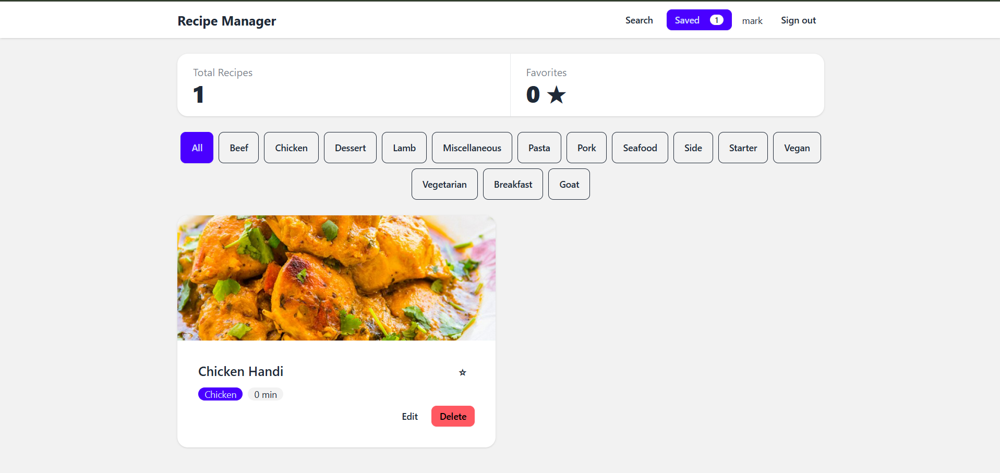

:::writing{variant="document" id="63821"}
https://recipe-manager-sepia.vercel.app/



# Recipe Manager

A multi-page recipe application built with React, TypeScript, React Router, Axios, and TanStack Query. Users can search meals from TheMealDB, view recipe details, save recipes, manage favorites, and edit saved recipes.

## Features

- Search for recipes using TheMealDB API.
- View complete recipe details and ingredients.
- Save and manage recipes.
- Edit saved recipe information.
- Manage favorite recipes.
- Filter saved recipes.
- Sign in using a display name.
- Protect the Saved Recipes page with authentication.
- Persist saved recipes and login sessions using localStorage.
- Navigate between pages using React Router.

## Technologies Used

- React
- TypeScript
- React Router DOM
- Axios
- TanStack Query
- TheMealDB API
- Tailwind CSS
- DaisyUI
- Vite
- Vercel

## Installation and Setup

1. Clone the repository:

   ```bash
   git clone https://github.com/marksilva-123/recipe-manager.git
   ```

2. Open the project folder:

   ```bash
   cd recipe-manager
   ```

3. Install dependencies:

   ```bash
   npm install
   ```

4. Create a `.env` file in the project root using `.env.example` as a guide.

   Add the following environment variable:

   ```env
   VITE_MEALDB_URL=https://www.themealdb.com/api/json/v1/1
   ```

5. Start the development server:

   ```bash
   npm run dev
   ```

6. Open the local URL displayed by Vite in your browser.

## Available Scripts

| Command | Description |
|---|---|
| `npm run dev` | Starts the development server |
| `npm run build` | Builds the production application |
| `npm run preview` | Previews the production build |

## Application Routes

| Route | Description |
|---|---|
| `/` | Search meals from TheMealDB |
| `/login` | Sign in using a display name |
| `/saved` | View and manage saved recipes (protected) |
| `/recipe/:mealId` | View complete recipe details |
| `*` | Display the Not Found page |

## Authentication and Data Persistence

The application uses React Context to manage authentication state.

- Users can sign in using a display name.
- Authentication state persists after refreshing the page.
- The Saved Recipes page is protected.
- Unauthenticated users are redirected to the login page.
- After signing in, users can return to their originally requested page.
- Saved recipes are stored in localStorage.

## API Configuration

The application uses TheMealDB API to retrieve recipe information.

Environment variable:

```env
VITE_MEALDB_URL=https://www.themealdb.com/api/json/v1/1
```

The `.env.example` file is included in the repository. The actual `.env` file is excluded from Git.

## Deployment

The application is deployed using Vercel.

Live application: https://recipe-manager-sepia.vercel.app/

The `vercel.json` configuration rewrites application routes to `index.html` to support React Router navigation and direct route refreshes.

## Production Build

To verify the production build:

```bash
npm run build
```

To preview the production build locally:

```bash
npm run preview
```

:::